<div align="center">

# Eigenvalues & Eigenvectors
### *The directions a matrix cannot turn*

**M3 · Linear Algebra & Calculus · Internal Assessment: Animation Video (Project Option 1)**

[](https://www.manim.community/)
[](https://www.python.org/)


<a href="https://drive.google.com/file/d/1Bg-JTx9E6Rao8Uu7pf5SqVRYHgb89PBw/view?usp=drive_link">
  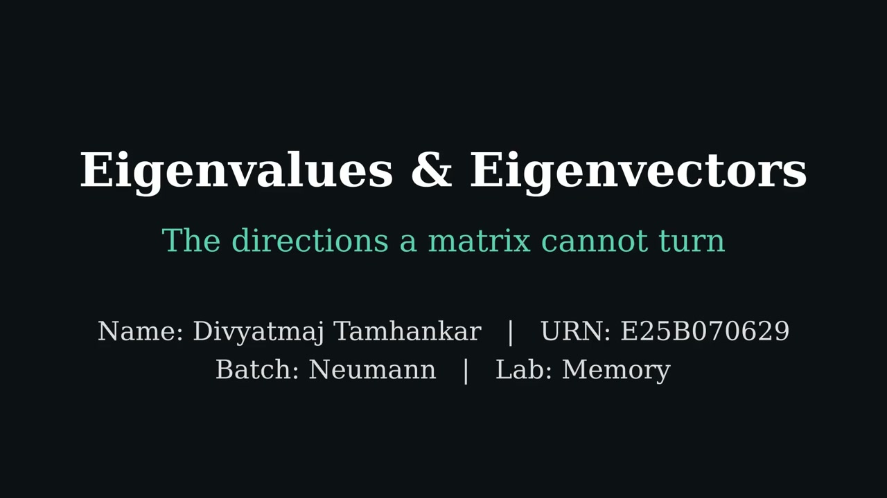
</a>

### ▶️ [**Watch the full video on Google Drive**](https://drive.google.com/file/d/1Bg-JTx9E6Rao8Uu7pf5SqVRYHgb89PBw/view?usp=drive_link)

<sub>GitHub can't preview a 59 MB video in the browser, so use the Drive link above.
The original file is also in this repo: <a href="eigen_video_final.mp4"><code>eigen_video_final.mp4</code></a> (open it, then click <b>View raw</b> / download).</sub>

| | |
|:--|:--|
| **Student** | Divyatmaj Tamhankar |
| **URN** | E25B070629 |
| **Batch / Lab** | Neumann / Memory |
| **Topic** | Eigenvalues and eigenvectors (Linear Algebra) |

</div>

---

## 🎯 Learning objective

> **By the end of this video, the viewer will be able to** explain what $A\mathbf{v} = \lambda\mathbf{v}$ means geometrically, and compute the eigenvalues and eigenvectors of a $2 \times 2$ matrix by hand.

The whole video uses one running example:

$$
A = \begin{pmatrix} 2 & 1 \\ 1 & 2 \end{pmatrix},
\qquad
\lambda_1 = 3,\ \mathbf{v}_1 = \begin{pmatrix} 1 \\ 1 \end{pmatrix},
\qquad
\lambda_2 = 1,\ \mathbf{v}_2 = \begin{pmatrix} 1 \\ -1 \end{pmatrix}
$$

---

## 🎬 Preview

<table>
  <tr>
    <td align="center" width="50%">
      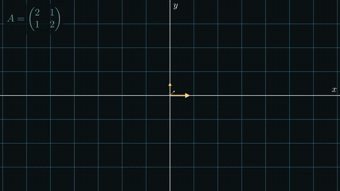<br>
      <b>The hook:</b> A turns almost every arrow. Only two stay on their own lines.
    </td>
    <td align="center" width="50%">
      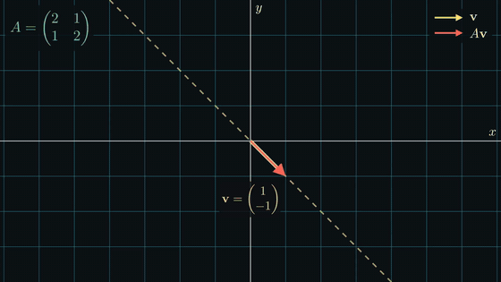<br>
      <b>The sweep:</b> as <b>v</b> goes round a circle, <b>Av</b> traces an ellipse, and the two line up exactly twice.
    </td>
  </tr>
</table>

**Colour code, used the same way in every scene:**
🟦 teal = the matrix $A$ · 🟨 yellow = input $\mathbf{v}$ · 🟥 red = output $A\mathbf{v}$ · 🟩 green = eigenpair $(\lambda=3,\ \mathbf{v}_1)$ · 🟧 orange = eigenpair $(\lambda=1,\ \mathbf{v}_2)$

---

## 🗺️ Storyboard: how the video is structured

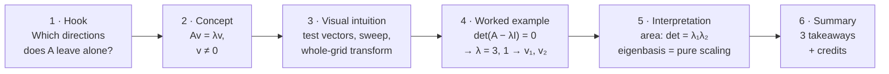

| # | Storyboard scene | Parts of the video | Starts at | What happens |
|:-:|:--|:--|:-:|:--|
| 1 | **Hook / Context** | Opening frame, Hook | 0:00 | Title card, then six arrows hit by one matrix. Most turn; two don't. *Which directions does a matrix leave alone?* |
| 2 | **Concept Introduction** | Definition | 0:38 | Formal definition $A\mathbf{v}=\lambda\mathbf{v}$, why $\mathbf{v}\neq\mathbf{0}$, stretch / shrink / flip panels, learning objective |
| 3 | **Visual Intuition** | Testing vectors, Sweep, Grid | 1:34 | Test $(1,0)$, $(1,1)$, $(1,-1)$; sweep $\mathbf{v}$ round a circle; watch $A$ act on the whole plane |
| 4 | **Worked Example** | Derivation, Solving, Eigenvectors | 2:51 | Derive $\det(A-\lambda I)=0$ (proof by contradiction), solve $\lambda^2-4\lambda+3=0$, find $\mathbf{v}_1,\mathbf{v}_2$, check by substitution |
| 5 | **Interpretation** | Area, Eigenbasis | 4:45 | Area $2 \to 6$, so $\det A = \lambda_1\lambda_2$ and $\operatorname{tr}A = \lambda_1+\lambda_2$; any vector as a sum of eigenvectors |
| 6 | **Summary & Credits** | Recap, Closing | 5:45 | Three takeaways, references, student details |

<details>
<summary><b>Detailed timestamps (13 parts)</b></summary>

| Time | Part |
|:-:|:--|
| 0:00 | Opening frame: title, name, URN |
| 0:10 | Hook: six arrows, one matrix |
| 0:38 | Definition and learning objective |
| 1:34 | Testing three vectors |
| 2:14 | Sweeping **v** around a circle |
| 2:40 | $A$ acting on the whole grid |
| 2:51 | Deriving the characteristic equation |
| 3:24 | Solving $\det(A-\lambda I)=0$ |
| 3:51 | Finding the eigenvectors and checking them |
| 4:45 | Area: determinant = product of eigenvalues |
| 5:18 | Writing a vector in the eigenvector basis |
| 5:45 | Three takeaways |
| 6:19 | References and credits |

</details>

---

## 🧮 The mathematics, scene by scene

<table>
  <tr>
    <td width="50%">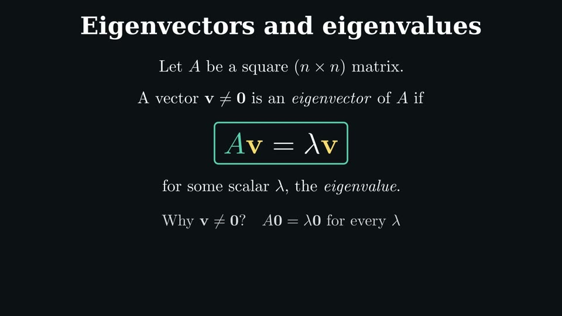</td>
    <td width="50%">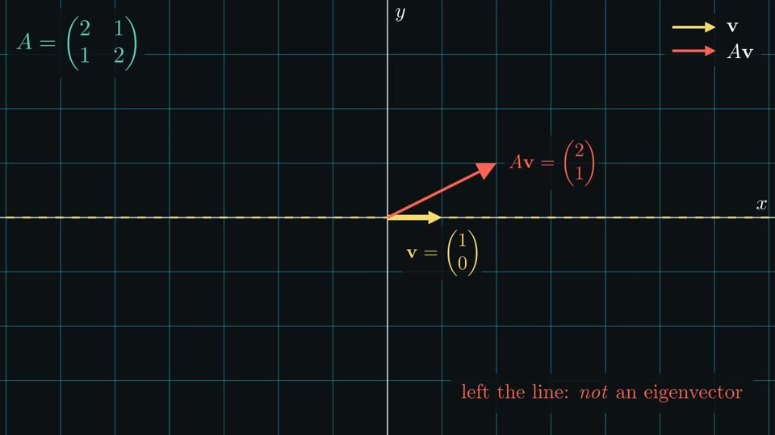</td>
  </tr>
  <tr>
    <td align="center"><b>Definition.</b> A nonzero <b>v</b> with A<b>v</b> = λ<b>v</b>.</td>
    <td align="center"><b>Testing.</b> (1,0) ↦ (2,1) leaves its line, so it is <i>not</i> an eigenvector.</td>
  </tr>
  <tr>
    <td>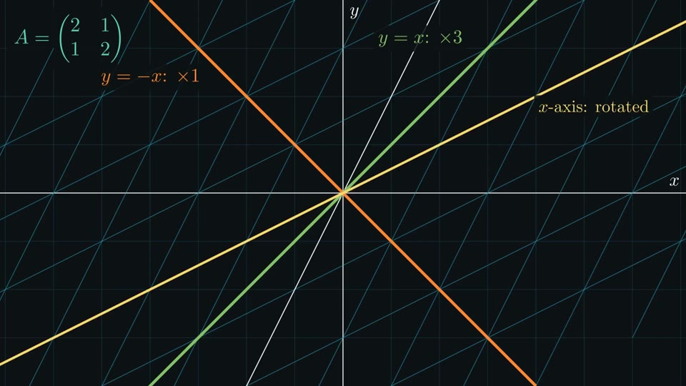</td>
    <td>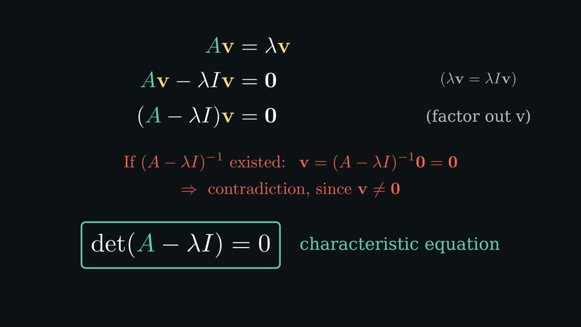</td>
  </tr>
  <tr>
    <td align="center"><b>Whole grid.</b> y = x is stretched ×3, y = −x is fixed, every other line turns.</td>
    <td align="center"><b>Derivation.</b> If A − λI were invertible, <b>v</b> would be <b>0</b>. So det(A − λI) = 0.</td>
  </tr>
  <tr>
    <td>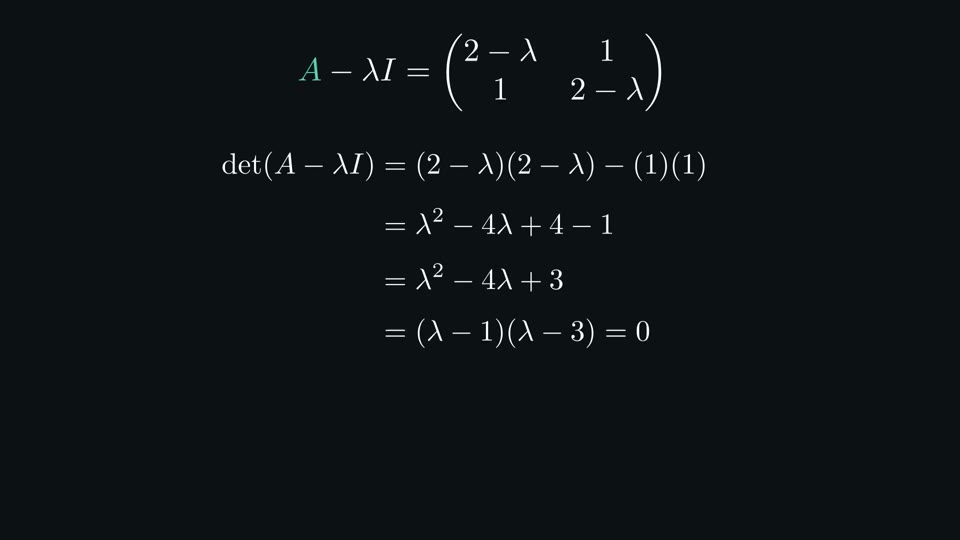</td>
    <td>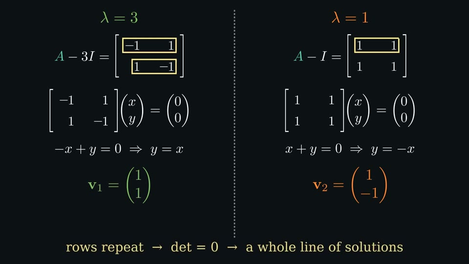</td>
  </tr>
  <tr>
    <td align="center"><b>Solve.</b> λ² − 4λ + 3 = (λ − 1)(λ − 3) = 0.</td>
    <td align="center"><b>Eigenvectors.</b> Rows repeat because det = 0, which gives a whole line of solutions.</td>
  </tr>
  <tr>
    <td>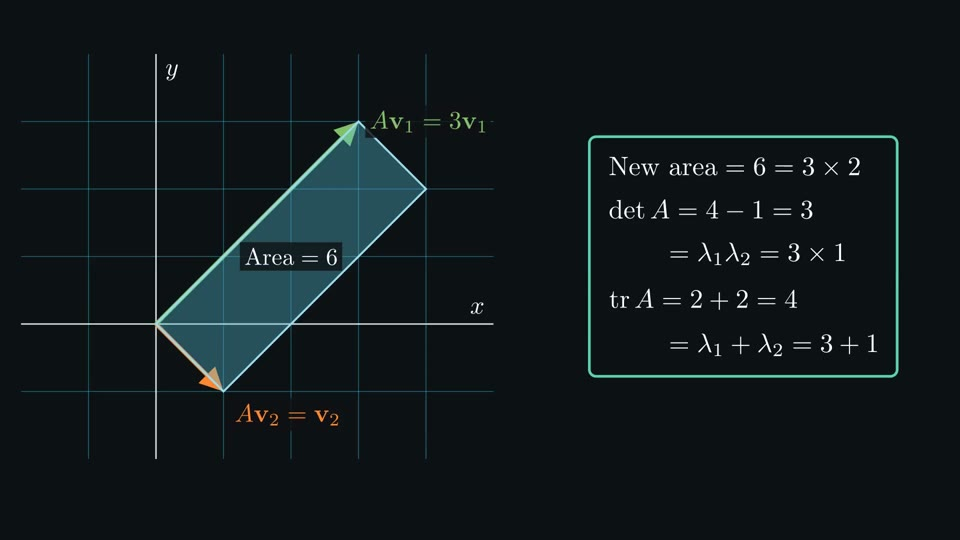</td>
    <td>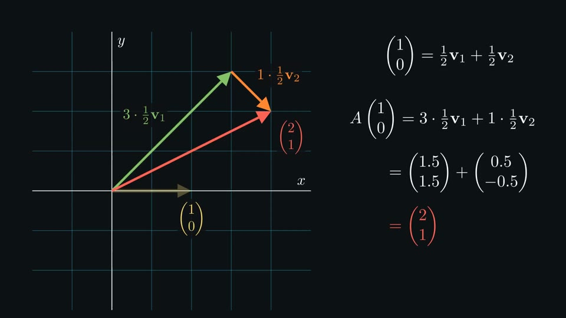</td>
  </tr>
  <tr>
    <td align="center"><b>Area.</b> 2 → 6, so det A = 3 = λ₁λ₂ and tr A = 4 = λ₁ + λ₂.</td>
    <td align="center"><b>Eigenbasis.</b> (1,0) = ½<b>v</b>₁ + ½<b>v</b>₂, so A(1,0) = 3·½<b>v</b>₁ + 1·½<b>v</b>₂ = (2,1).</td>
  </tr>
</table>

<details>
<summary><b>Full worked example, written out</b></summary>

**Characteristic equation.** From $A\mathbf{v} = \lambda\mathbf{v}$:

$$
A\mathbf{v} - \lambda I\mathbf{v} = \mathbf{0}
\;\Longrightarrow\;
(A - \lambda I)\mathbf{v} = \mathbf{0}.
$$

If $(A-\lambda I)^{-1}$ existed, then $\mathbf{v} = (A-\lambda I)^{-1}\mathbf{0} = \mathbf{0}$, which contradicts $\mathbf{v}\neq\mathbf{0}$. Hence $\det(A-\lambda I) = 0$.

**Eigenvalues.**

$$
\det\begin{pmatrix} 2-\lambda & 1 \\ 1 & 2-\lambda \end{pmatrix}
= (2-\lambda)^2 - 1
= \lambda^2 - 4\lambda + 3
= (\lambda-1)(\lambda-3) = 0
\;\Longrightarrow\; \lambda_1 = 3,\ \lambda_2 = 1.
$$

**Eigenvectors.**

$$
\lambda = 3:\ \begin{pmatrix} -1 & 1 \\ 1 & -1 \end{pmatrix}\!\begin{pmatrix} x \\ y \end{pmatrix} = \mathbf{0}
\Rightarrow y = x
\Rightarrow \mathbf{v}_1 = \begin{pmatrix} 1 \\ 1 \end{pmatrix}
\qquad
\lambda = 1:\ \begin{pmatrix} 1 & 1 \\ 1 & 1 \end{pmatrix}\!\begin{pmatrix} x \\ y \end{pmatrix} = \mathbf{0}
\Rightarrow y = -x
\Rightarrow \mathbf{v}_2 = \begin{pmatrix} 1 \\ -1 \end{pmatrix}
$$

**Check by substitution.** $A\mathbf{v}_1 = (3,3)^T = 3\mathbf{v}_1$ ✓, and $A\mathbf{v}_2 = (1,-1)^T = 1\,\mathbf{v}_2$ ✓.

**Interpretation.** $\det A = 4 - 1 = 3 = \lambda_1\lambda_2$ (area scale factor) and $\operatorname{tr}A = 2 + 2 = 4 = \lambda_1 + \lambda_2$.

</details>

> ✅ **Every number on screen is machine-checked.** The script contains `assert` statements (lines 48–60) that verify each eigenpair, the determinant, trace, areas and the basis decomposition with NumPy **before anything is drawn**. If any number were wrong, the render would stop.

---

## 💡 Three takeaways

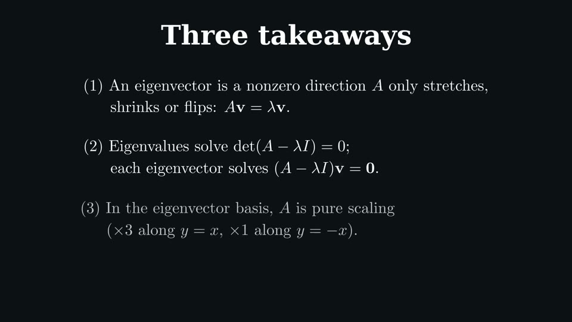

1. An **eigenvector** is a nonzero direction that $A$ only stretches, shrinks or flips: $A\mathbf{v} = \lambda\mathbf{v}$.
2. **Eigenvalues** solve $\det(A - \lambda I) = 0$; each **eigenvector** solves $(A - \lambda I)\mathbf{v} = \mathbf{0}$.
3. In the **eigenvector basis**, $A$ is pure scaling: ×3 along $y = x$ and ×1 along $y = -x$.

---

## 📁 Repository contents

```
.
├── EigenValues-and-EigenVectors.py   # complete Manim source for the whole video
├── eigen_video_final.mp4             # final rendered video (1920×1080, 16:9, 6:29)
├── assets/                           # stills and GIFs used in this README
└── README.md
```

### How the code is organised

| Section | What it contains |
|:--|:--|
| **1. Constants** | Student details, the colour code, the matrix $A$, its eigenpairs, and the NumPy `assert` checks |
| **2. Narration** | The full voice-over script (`NARRATION` dict), one entry per spoken line |
| **3. `EigenBase` scene** | Narration timing (`say` / `finish`), drawing helpers, and one method per part (`part01_opening` … `part13_closing`) |
| **4. Scenes** | `FullVideo` (plays every part in order) plus `Part01Opening` … `Part13Closing` for rendering one part at a time |

Each `say()` call also writes a subtitle, so Manim outputs a `FullVideo.srt` with exact timings. That file was used to line up the recorded voice-over with the animation.

---

## ⚙️ Reproducing the video

**Requirements:** Python 3.10+, [Manim Community Edition](https://docs.manim.community/en/stable/installation.html) v0.18+, a LaTeX distribution (MacTeX / TeX Live / MiKTeX) and FFmpeg.

```bash
pip install manim

# full video, 1080p at 30 fps
manim -qh --fps 30 EigenValues-and-EigenVectors.py FullVideo

# a single part, low quality (fast preview)
manim -ql EigenValues-and-EigenVectors.py Part05Sweep
```

The output goes to `media/videos/EigenValues-and-EigenVectors/1080p30/FullVideo.mp4`, together with `FullVideo.srt`. The narration was recorded separately and added over the rendered animation.

---

## 📚 References & credits

- G. Strang, *Introduction to Linear Algebra*, 5th ed., Chapter 6 (Eigenvalues and Eigenvectors)
- 3Blue1Brown, *Essence of Linear Algebra*, Chapter 14 (inspiration for the visual style only; no footage reused)
- [Manim Community Edition](https://www.manim.community/), the animation engine
- **Music:** none

## 🤖 AI disclosure

Animation code and the narration draft were prepared with help from an AI assistant. All mathematics was checked by hand by the student, and the voice-over was recorded by the student. This README was also drafted with the help of an AI assistant.

---

<div align="center">

**[▶️ Watch the video](https://drive.google.com/file/d/1Bg-JTx9E6Rao8Uu7pf5SqVRYHgb89PBw/view?usp=drive_link)** · Divyatmaj Tamhankar · E25B070629

</div>
